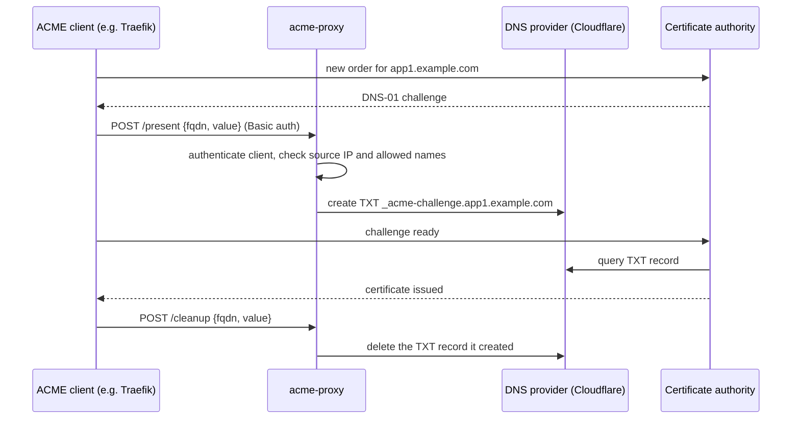

# acme-proxy

acme-proxy publishes ACME DNS-01 challenge records on behalf of internal hosts,
so that those hosts can obtain publicly trusted TLS certificates without ever
holding DNS provider credentials.

> **Status:** early development. Cloudflare is the only supported DNS provider.
> Built for, and used in, a segmented homelab. Read the [security model](#security-model)
> before deploying it.

## Why

DNS-01 is the only ACME challenge that works for services that are not reachable
from the Internet: the certificate authority checks a TXT record instead of
connecting to the host. The catch is that every host requesting a certificate
needs an API token for your DNS provider.

With many providers, Cloudflare included, an API token cannot be restricted to a
single record or subdomain: it can edit the **entire zone**. If a token lives on
every host that runs a reverse proxy, a single compromised host can rewrite any
DNS record and obtain valid certificates for any name in your domain.

acme-proxy moves the DNS token to one dedicated, hardened host. Clients get
their own credentials, which only allow publishing the challenge record for the
names they are entitled to, and only from their own IP address.

## How it works



- The ACME client still runs on each host: **private keys and ACME accounts never
 leave the host** that uses them.
- Clients connect to the proxy, never the other way around. The proxy only
 initiates connections to the DNS provider API.
- The proxy speaks the `httpreq` protocol of [lego](https://go-acme.github.io/lego/dns/httpreq/),
 so any lego-based client (Traefik included) works with configuration only.

## Security model

### Assets

| Asset | Where it lives |
|---|---|
| DNS provider API token | acme-proxy host only |
| Integrity of DNS records in the zone | DNS provider |
| Certificate private keys and ACME account keys | each client host, never sent to the proxy |
| Client credentials | token on the client, SHA-256 hash on the proxy |

### Trust boundaries

1. **Client → proxy.** Untrusted input. Every request is authenticated, bound to
  a source IP and validated against an allowlist of names.
2. **Proxy → DNS provider.** Uses the zone token. The proxy only ever creates or
  deletes TXT records whose name starts with `_acme-challenge.`.
3. **Certificate authority → DNS.** Public validation, outside the scope of this
  project.

### Threats and mitigations

| Threat | Impact without acme-proxy | Mitigation |
|---|---|---|
| Compromised client host | Full control of the DNS zone | Client can only publish challenges for its own allowed names; no DNS token on the host |
| Stolen client credentials | Same as above | Credentials are bound to the client's source IP; useless from elsewhere |
| Malformed or malicious requests | n/a | Strict validation: exact names only, fixed TXT value format, request size limits, unknown fields rejected |
| Attacker on the network between client and proxy | n/a | HTTPS by default, with a publicly trusted certificate obtained by the proxy itself |
| Leaked proxy configuration file | n/a | Contains only SHA-256 hashes of high-entropy random tokens |
| Compromised proxy host | n/a | Exposes the DNS token, which is the status quo on every host without acme-proxy. Run it on a dedicated, isolated host |

### Non-goals

- Storing, issuing or distributing certificates or private keys.
- Acting as a DNS server or as an ACME (RFC 8555) proxy.
- Supporting every DNS provider.
- Protecting against a compromised proxy host. Isolate it accordingly.

## Design decisions

**Random tokens and SHA-256, not passwords and bcrypt.** Credentials are generated
by the proxy (32 random bytes), never chosen by a person. Slow password hashes
exist to protect low-entropy secrets; for a 256-bit random token a plain SHA-256
hash is sufficient and needs no dependency. Comparisons are constant-time.

**Source IP binding.** Each client lists the addresses it may connect from. A
stolen token is useless from another host. This requires that clients reach the
proxy without NAT in between; forwarded headers such as `X-Forwarded-For` are
never trusted.

**Exact names only.** A client may publish challenges only for the names
explicitly listed for it; there is no subdomain matching. Note that allowing a
name also allows a wildcard certificate for its direct subdomains: with DNS-01,
`name` and `*.name` are validated through the same `_acme-challenge.name` record,
so the proxy cannot tell them apart.

**Minimal dependencies.** Go standard library plus `golang.org/x/crypto/acme`,
maintained by the Go team. Configuration is JSON so that no third-party parser is
needed. The container image contains only the static binary.

**The proxy obtains its own certificate.** HTTPS is enabled by default and the
proxy requests its own certificate through the same DNS provider, so there is no
extra component to deploy. Plain HTTP can be enabled explicitly for local
testing; the proxy logs a warning at startup when it is.

**Pull model.** Clients connect to the proxy. The proxy never needs network access
to clients, which keeps firewall rules minimal in segmented networks.

## Compatibility

| Client | Protocol | Status |
|---|---|---|
| lego (`httpreq`, default mode) | `/present`, `/cleanup` | target |
| Traefik (uses lego) | same | target |
| acme.sh (`dns_acmeproxy`) | same | untested |
| Caddy (`dns.providers.acmeproxy`) | same | untested |

The `httpreq` raw mode is not supported.

acme-proxy is an independent project. It is not a fork of the earlier
`acmeproxy` project, although it implements the same lego `httpreq` protocol.

## Configuration

```json
{
 "listen": ":8443",
 "tls": {
   "mode": "acme",
   "hostname": "acme-proxy.example.com",
   "email": "admin@example.com",
   "state_dir": "/var/lib/acme-proxy"
 },
 "dns": {
   "provider": "cloudflare",
   "zone": "example.com",
   "token_file": "/run/secrets/cloudflare_token"
 },
 "clients": [
   {
     "name": "app1",
     "token_sha256": "<hex-encoded SHA-256 of the client token>",
     "sources": ["192.0.2.10/32"],
     "domains": ["app1.example.com"]
   }
 ]
}
```

| Field | Meaning |
|---|---|
| `tls.mode` | `acme` (default) or `off` (plain HTTP, testing only) |
| `dns.token_file` | file containing the DNS API token; never put the token in this file |
| `clients[].sources` | CIDR prefixes the client may connect from |
| `clients[].domains` | exact names the client may publish challenges for |

The configuration is reloaded on `SIGHUP`, so clients can be added without a
restart.

### Adding a client

```sh
acme-proxy new-client app1
```

prints a random token, to be stored as a secret on the client, and its SHA-256
hash, to be added to the configuration. The token is shown once and is not
stored by the proxy.

## Deployment

Container images are published to `ghcr.io/marcobonomi/acme-proxy` and signed with
[cosign](https://github.com/sigstore/cosign) (keyless, bound to this repository's
release workflow). Configure Podman to accept only signed images before pulling.

Example Podman quadlet (`/etc/containers/systemd/acme-proxy.container`):

```ini
[Container]
Image=ghcr.io/marcobonomi/acme-proxy:<version>
PublishPort=443:8443
Volume=/etc/acme-proxy/config.json:/etc/acme-proxy/config.json:ro
Volume=/var/lib/acme-proxy:/var/lib/acme-proxy
Secret=cloudflare_token,target=/run/secrets/cloudflare_token
ReadOnly=true
User=65532
DropCapability=all
NoNewPrivileges=true

[Service]
Restart=always

[Install]
WantedBy=multi-user.target
```

Recommended placement: a dedicated host or container in a management network,
reachable only from client hosts on the listening port, with no inbound access
from the Internet.

## Client setup

Traefik static configuration:

```yaml
certificatesResolvers:
 le:
   acme:
     email: admin@example.com
     storage: /letsencrypt/acme.json
     dnsChallenge:
       provider: httpreq
```

Environment of the Traefik container:

```sh
HTTPREQ_ENDPOINT=https://acme-proxy.example.com
HTTPREQ_USERNAME=app1
HTTPREQ_PASSWORD=<client token>   # use a secret, not a plain variable
```

## Development

```sh
make test    # unit tests
make lint    # go vet + staticcheck
make build   # static binary in ./bin
```

Integration tests run against the Let's Encrypt staging environment.

## Security

See [SECURITY.md](SECURITY.md) for how to report vulnerabilities.

## License

Apache License 2.0. See [LICENSE](LICENSE).